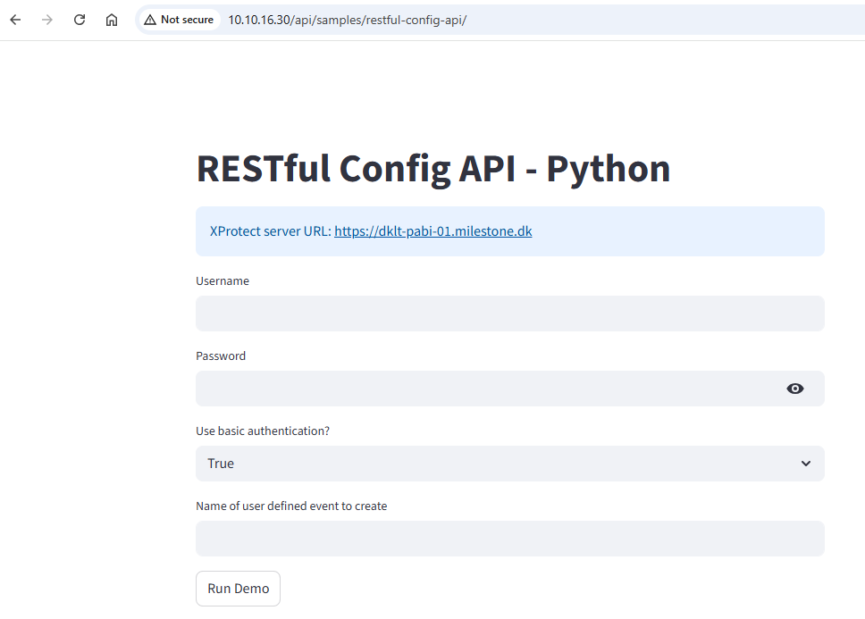

# RESTful Config API Sample

A sample application demonstrating how to use the XProtect API Gateway from an App Center application. The sample creates, gets, updates, and deletes a user-defined event, with diagnostic output along the way.

The frontend is a microfrontend (MFE) for the Smart Client, built with React and Module Federation. It needs no login: the Smart Client shell adds the access token of the current Smart Client session to every request the MFE makes, and a small Python backend-for-frontend (FastAPI) forwards that token to the XProtect API Gateway. Operations are therefore performed as the user who is signed in to the Smart Client.



## Prerequisites

- XProtect installation
- The API Gateway installed on the same host as the management server
- A Smart Client version with microfrontend support (2026 R1 or later), signed in with a user that has the Administrators role
- **System Native Shell App** (`system-native-shell-app`) installed from the App Center on the same App Platform
- Python version 3.10 or newer and Node.js 18 or newer (for building)
- Access to the `@milestone` npm registry, see the `.npmrc` file in `containers/restful-config-api/client`

## How it works

```
Smart Client shell ── loads /mfe/samples/restful-config-api/remote-entry.js (the MFE)
        │
        │  fetch /mfe/samples/restful-config-api/api/...
        │  (shell adds "Authorization: Bearer <session access token>")
        ▼
Python BFF (FastAPI, main.py) ── forwards the same token ──▶ XProtect API Gateway
```

- `app-definition.yaml` registers the MFE in the `microfrontends` section, targeting the `smart-client`, and exposes both the MFE files and the `/api/` routes through the ingress. The `/api/` rule requires the `managementserver` scope.
- The backend does not validate the token itself; the API Gateway does when the token is forwarded. Requests without a bearer token are rejected with `401`.

### Environment Variables

The container runtime provides these variables:

| Variable | Description | Example |
|----------|-------------|---------|
| `LEGACY_USE_TLS` | Whether XProtect server uses TLS | `true` or `false` |
| `LEGACY_MANAGEMENT_SERVER` | Management Server hostname | `your-management-server.com` |

## Local Development

1. **Run the backend:**
   ```bash
   cd containers/restful-config-api/app
   pip install -r requirements.txt
   cd src
   LEGACY_USE_TLS=true LEGACY_MANAGEMENT_SERVER=your-management-server.com python main.py
   ```
   The backend listens on port 8080 (override with `PORT`). If `../client` contains a built MFE it is served as well.

2. **Run the MFE standalone:**
   ```bash
   cd containers/restful-config-api/client
   npm install
   ACCESS_TOKEN='<bearer token from the XProtect IDP>' BACKEND_URL=http://localhost:8080 npm start
   ```
   In standalone mode there is no Smart Client shell to supply the session token, so the dev server attaches `ACCESS_TOKEN` to proxied `/api` requests. Open http://localhost:3003.

3. **Run in a shell:** `npm run start:federation` serves `remote-entry.js` from http://localhost:3003; register it in a shell with `{ registration: { mfe: { path: "http://localhost:3003/remote-entry.js" } } }`.

## Project Structure

```
restful-config-api/
├── app-definition.yaml             # App Center configuration (incl. microfrontend registration)
├── Makefile                        # Build automation (builds the MFE, then the image)
├── containers/
│   └── restful-config-api/
│       ├── Dockerfile              # Container build instructions
│       ├── app/
│       │   ├── requirements.txt    # Python dependencies
│       │   └── src/
│       │       ├── main.py         # Backend-for-frontend, also serves the MFE
│       │       └── api_gateway.py  # API Gateway client
│       └── client/                 # The Smart Client microfrontend
│           ├── public/manifest.json # MFE manifest and fragment definition
│           ├── src/App.tsx         # UI
│           ├── src/api.ts          # Calls to the backend
│           └── webpack.config.js   # Module Federation configuration
└── README.md                       # This file
```

## Porting Existing Python MIP Integration

This sample was ported from the existing protocol integration sample [RestfulCommunicationPython](https://github.com/milestonesys/mipsdk-samples-protocol/tree/main/RestfulCommunicationPython).

### Steps to Port Your Python Integration:

1. **Create requirements file:** List all packages needed for pip installation based on your sample documentation

2. **Add a backend-for-frontend and a microfrontend:**
   - Convert the console application to a small HTTP API (this sample uses FastAPI) that takes the bearer token from the incoming request instead of logging in
   - Build the user interface as a Smart Client microfrontend (see `containers/restful-config-api/client`, generated with `npx @milestone/create-mfe-app`)

3. **Test locally:**
   - Verify the backend and the MFE work together, see Local Development above

4. **Containerize:**
   - Create Dockerfile following this sample's pattern
   - Test that your sample works in Docker container locally

5. **Deploy to App Center:**
   - Once container testing is successful, you can build, push, and install your application in the App Center, see details below.


### Building and Deploying to App Center

To build, push, and install the application:

```bash
cd src/restful-config-api
# Login is only required once to connect to the cluster
make login
# Build both the image and Helm chart
make build
# Push to the sandbox registry and repository
make push
# Install the application (equivalent to the install button in App Center UI)
make install-from-repo
```

### Verifying Deployment

After deployment, verify that the application is running:

```bash
# List installed applications
make list
# View application events
make events
```

Once installed, the **RESTful Config API** microfrontend is available in the Smart Client. The MFE files are served at `http://<system-ip>/mfe/samples/restful-config-api/`.